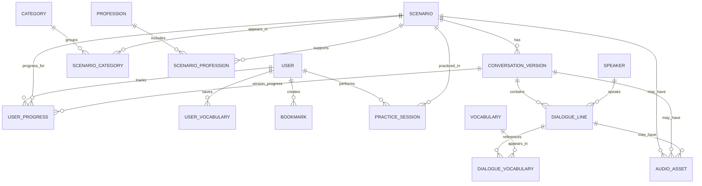
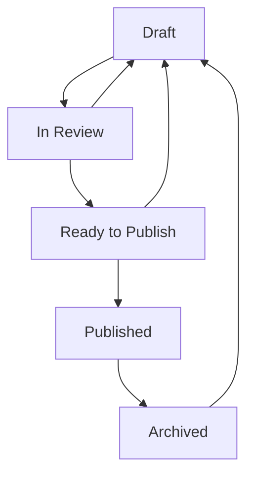

# English Conversation Practice — Database Architecture & Schema Plan

**Document:** Database Design & Implementation Guide  
**Version:** 1.0  
**Status:** Planning specification for Antigravity  
**Scope:** Learner platform, conversation content library, learning progress, practice activities, and admin content management

---

## 1. Purpose

This document defines how the English Conversation Practice platform should organise, store, relate, secure, and evolve its data.

The platform is conversation-first. Its central content flow is:

**Category / Profession → Scenario → Conversation Version → Speaker & Dialogue Lines → Translation / Vocabulary / Grammar / Audio → Learner Practice & Progress**

The database must support:

- Daily-life and professional conversation learning.
- One scenario appearing in multiple categories and professional paths without duplicate scenario records.
- Multiple conversation versions for one scenario, such as easy/normal/hard, short/medium/long, and casual/neutral/formal.
- Sentence-level translations and additional languages in the future.
- Reusable vocabulary, grammar explanations, and audio assets.
- Learner bookmarks, saved vocabulary, practice history, and progress.
- Admin drafting, reviewing, publishing, unpublishing, and archiving content.
- Optional learning assets: a draft must be saveable even when some translations, audio, or explanations are not ready.

This is a database planning document, not an instruction to create every future feature in the first development phase.

---

## 2. Important implementation principle

The existing project brief says the implementation must inspect the actual workspace and must not assume a framework, database, authentication provider, or hosting provider.

Therefore:

1. First inspect the existing repository and identify its stack.
2. If a database has already been selected, follow the existing project architecture unless there is a concrete reason to change it.
3. If the database is not yet selected, use a relational database as the preferred model because the content has clear relationships and needs reliable references.
4. PostgreSQL is a suitable recommended option, but it is a recommendation, not an assumption about the current project.
5. Do not introduce a second database just to follow this document.
6. Use migrations for every schema change. Do not make undocumented production schema edits.

### Source vs recommendation

- **Project-brief requirements** are carried forward from `English_Conversation_Partner_Project_Brief.md`.
- **Implementation recommendations** in this document (such as UUID primary keys, audit logs, indexes, and specific constraint patterns) are engineering suggestions to make those requirements reliable. Antigravity must validate them against the actual stack.

---

## 3. Database design principles

### 3.1 Normalise reusable content

Store a scenario once. Connect it to multiple categories and professions through join tables. Do not copy the same scenario for every category in which it appears.

### 3.2 Keep source English separate from translations

English dialogue is the source content. Translations belong in separate records and must identify their language and review status. Do not put Bangla text directly into the English source field.

### 3.3 Model conversation variants explicitly

A scenario can have several conversation versions. Each version has its own level, length type, communication style, and ordered dialogue lines.

### 3.4 Use stable relationships

Use foreign keys for relationships such as scenario-to-version, version-to-dialogue-line, dialogue-line-to-speaker, and learner-to-progress. Avoid storing related records as unvalidated text or comma-separated IDs.

### 3.5 Optional assets must remain optional

A scenario can be saved as a draft without all optional translations, audio, vocabulary, or grammar content. Publication validation should check required fields and references without requiring every possible asset.

### 3.6 Keep learner data separate from editorial content

Learner progress, bookmarks, and saved vocabulary must not be stored inside the scenario or dialogue records.

### 3.7 Avoid unnecessary personal data

Store only information required for authentication, learning preferences, and product functionality. Do not collect unrelated personal details.

### 3.8 Plan for future growth without premature complexity

The first release should support the core learning experience. AI speaking sessions, advanced analytics, subscriptions, and additional content workflows can be added through later migrations.

---

## 4. High-level entity map



The diagram shows the main relationships. Translation and grammar records are attached to their target content through the target model described in sections 8 and 9. If the chosen ORM or database does not support safe polymorphic references, use explicit nullable foreign keys or separate target-specific translation tables instead of an unchecked `source_type + source_id` pair.

---

## 5. Core tables

The following schema is a logical design. Exact SQL types and naming should be adapted to the project's database and ORM.

### 5.1 `users`

Stores the learner's account reference and learning preferences.

| Field | Suggested type | Required | Notes |
|---|---|---:|---|
| `id` | UUID / native user ID | Yes | Primary key; use the auth provider's stable ID if appropriate |
| `display_name` | varchar | Yes | Public display name |
| `email` | varchar | Depends | Only if managed by this application; otherwise keep auth provider reference |
| `auth_user_id` | varchar / UUID | Depends | External authentication reference if auth is separate |
| `preferred_translation_language` | varchar(10) | No | Example: `bn`; default can be set at app level |
| `preferred_accent` | varchar(20) | No | Example: `us` or `uk` |
| `learning_level` | varchar(10) | No | CEFR-inspired level such as A1–C2 |
| `learning_goal` | text | No | Optional learner goal |
| `created_at` | timestamp | Yes | Creation time |
| `updated_at` | timestamp | Yes | Last update |

**Rules**

- Do not store passwords in this table when using a managed authentication provider.
- Enforce uniqueness on the auth reference and on email only if email is managed locally.
- Keep preference fields optional so registration remains simple.
- If the auth provider already owns user profiles, avoid duplicating sensitive account data.

### 5.2 `categories`

Supports daily-life, social, special-situation, and other discovery groupings. Parent-child categories are supported.

| Field | Suggested type | Required | Notes |
|---|---|---:|---|
| `id` | UUID | Yes | Primary key |
| `name` | varchar(120) | Yes | Display name |
| `slug` | varchar(140) | Yes | Unique URL-safe identifier |
| `description` | text | No | Short description |
| `parent_category_id` | UUID | No | Self-reference to `categories.id` |
| `display_order` | integer | Yes | Sort order; default 0 |
| `status` | enum / varchar | Yes | `draft`, `published`, `archived` |
| `created_at` | timestamp | Yes | Creation time |
| `updated_at` | timestamp | Yes | Last update |

Use a unique constraint on `slug`. Prevent a category from being its own parent and guard against circular parent relationships in application logic or database-supported constraints.

### 5.3 `professions`

Stores professional English learning paths and job roles.

| Field | Suggested type | Required | Notes |
|---|---|---:|---|
| `id` | UUID | Yes | Primary key |
| `name` | varchar(120) | Yes | Profession name |
| `slug` | varchar(140) | Yes | Unique URL-safe identifier |
| `description` | text | No | Description of the learning path |
| `industry` | varchar(120) | No | Industry grouping |
| `display_order` | integer | Yes | Sort order; default 0 |
| `status` | enum / varchar | Yes | `draft`, `published`, `archived` |
| `created_at` | timestamp | Yes | Creation time |
| `updated_at` | timestamp | Yes | Last update |

### 5.4 `scenarios`

The central content entity. A scenario describes a real-life or professional situation that can be used for one or more conversation versions.

| Field | Suggested type | Required | Notes |
|---|---|---:|---|
| `id` | UUID | Yes | Primary key |
| `title` | varchar(180) | Yes | Scenario title |
| `slug` | varchar(200) | Yes | Unique URL-safe identifier |
| `description` | text | Yes | Short learner-facing description |
| `context` | text | No | Situation/background |
| `learning_objective` | text | No | What the learner should practise |
| `primary_category_id` | UUID | No | Optional main category; secondary links use join table |
| `level` | varchar(10) | No | Suggested overall level, e.g. A2 |
| `estimated_duration` | integer | No | Estimated minutes |
| `status` | enum / varchar | Yes | Editorial status |
| `created_by` | UUID | No | Admin/editor user reference |
| `updated_by` | UUID | No | Last editor reference |
| `published_at` | timestamp | No | Publication time |
| `created_at` | timestamp | Yes | Creation time |
| `updated_at` | timestamp | Yes | Last update |

**Important:** `primary_category_id` is optional. The many-to-many category relationship is stored in `scenario_categories`. If the team decides there is no need for a primary category, remove this field and treat all categories equally.

### 5.5 `scenario_categories`

Join table allowing one scenario to appear in multiple categories without duplication.

| Field | Suggested type | Required | Notes |
|---|---|---:|---|
| `scenario_id` | UUID | Yes | FK to `scenarios.id` |
| `category_id` | UUID | Yes | FK to `categories.id` |
| `display_order` | integer | No | Optional order within that category |
| `created_at` | timestamp | Yes | Link creation time |

**Constraints:** composite primary key or unique constraint on (`scenario_id`, `category_id`). Add indexes for both lookup directions.

### 5.6 `scenario_professions`

Join table connecting a scenario to one or more professional paths.

| Field | Suggested type | Required | Notes |
|---|---|---:|---|
| `scenario_id` | UUID | Yes | FK to `scenarios.id` |
| `profession_id` | UUID | Yes | FK to `professions.id` |
| `display_order` | integer | No | Optional order within the profession path |
| `created_at` | timestamp | Yes | Link creation time |

Use a composite primary key or unique constraint on (`scenario_id`, `profession_id`).

### 5.7 `conversation_versions`

A scenario can have multiple versions with different difficulty, length, or communication styles.

| Field | Suggested type | Required | Notes |
|---|---|---:|---|
| `id` | UUID | Yes | Primary key |
| `scenario_id` | UUID | Yes | FK to `scenarios.id` |
| `version_name` | varchar(120) | Yes | e.g. Beginner Version |
| `level` | varchar(10) | Yes | CEFR-inspired level |
| `length_type` | varchar(20) | Yes | `short`, `medium`, `long` |
| `communication_style` | varchar(20) | Yes | `casual`, `neutral`, `formal` |
| `version_description` | text | No | What makes this version different |
| `status` | enum / varchar | Yes | Editorial status |
| `display_order` | integer | Yes | Order within the scenario |
| `created_at` | timestamp | Yes | Creation time |
| `updated_at` | timestamp | Yes | Last update |

Use controlled values for `length_type` and `communication_style`. Validate level values in application code or a reference table. Do not assume every scenario needs every possible combination.

### 5.8 `speakers`

Stores reusable speaker identities/roles for dialogue.

| Field | Suggested type | Required | Notes |
|---|---|---:|---|
| `id` | UUID | Yes | Primary key |
| `name` | varchar(100) | Yes | Display label |
| `role` | varchar(120) | No | e.g. Customer, Receptionist |
| `voice_profile_reference` | varchar(180) | No | Reference to voice configuration; not an audio file itself |
| `created_at` | timestamp | Yes | Creation time |
| `updated_at` | timestamp | Yes | Last update |

Speaker records can be reused across dialogue versions where the role and identity are appropriate. If a speaker is specific to a single scenario, it can still be stored as a reusable record and referenced by that scenario's dialogue lines.

### 5.9 `dialogue_lines`

Stores the ordered English source dialogue for a conversation version.

| Field | Suggested type | Required | Notes |
|---|---|---:|---|
| `id` | UUID | Yes | Primary key |
| `conversation_version_id` | UUID | Yes | FK to `conversation_versions.id` |
| `speaker_id` | UUID | Yes | FK to `speakers.id` |
| `sequence_number` | integer | Yes | Position in the conversation |
| `english_text` | text | Yes | Source dialogue line |
| `learning_note` | text | No | Optional line-specific learning note |
| `created_at` | timestamp | Yes | Creation time |
| `updated_at` | timestamp | Yes | Last update |

**Constraints and behaviour**

- Unique (`conversation_version_id`, `sequence_number`).
- Sequence numbers should be positive.
- Reordering dialogue lines must update sequence numbers safely in a transaction.
- Keep source English text separate from translated text.
- A dialogue line may have no audio or translation while it is still a draft.

### 5.10 `translations`

Stores translations for supported languages. The project starts with Bangla as the first translation priority but must support additional languages.

The original brief proposes `source_type`, `source_id`, `language_code`, `translated_text`, and `review_status`. This is flexible, but a polymorphic `source_id` cannot normally use a standard foreign key to multiple target tables.

**Recommended safe implementation:** use a translation table with explicit nullable target foreign keys and a database check that exactly one target is populated.

| Field | Suggested type | Required | Notes |
|---|---|---:|---|
| `id` | UUID | Yes | Primary key |
| `scenario_id` | UUID | No | FK to `scenarios.id`, if scenario description/context is translated |
| `dialogue_line_id` | UUID | No | FK to `dialogue_lines.id` |
| `language_code` | varchar(10) | Yes | BCP 47-style code, e.g. `bn`, `en`, `hi` |
| `translated_text` | text | Yes | Natural contextual translation |
| `review_status` | varchar(20) | Yes | e.g. `draft`, `in_review`, `approved`, `rejected` |
| `reviewed_by` | UUID | No | Reviewer reference |
| `reviewed_at` | timestamp | No | Review time |
| `created_at` | timestamp | Yes | Creation time |
| `updated_at` | timestamp | Yes | Last update |

Add an exactly-one-target constraint for the supported target types. Add unique constraints on (`dialogue_line_id`, `language_code`) and, separately, (`scenario_id`, `language_code`) where the target is present.

If the application later needs translations for more entity types, extend the explicit target columns or create dedicated translation tables. Do not silently rely on an unconstrained polymorphic ID.

**Translation rules**

- Preserve meaning and intent, not word-for-word structure.
- Keep language code consistent across the application.
- Track review status; machine-generated text must not automatically be treated as approved.
- The learner should be able to reveal or hide translations.
- Sentence-level translations should be linked to the exact dialogue line they translate.

### 5.11 `vocabulary`

Stores reusable English vocabulary entries.

| Field | Suggested type | Required | Notes |
|---|---|---:|---|
| `id` | UUID | Yes | Primary key |
| `word` | varchar(160) | Yes | Display form |
| `lemma` | varchar(160) | No | Dictionary/base form |
| `pronunciation` | varchar(180) | No | Phonetic or readable pronunciation |
| `part_of_speech` | varchar(40) | No | Noun, verb, adjective, etc. |
| `general_definition` | text | No | General meaning |
| `created_at` | timestamp | Yes | Creation time |
| `updated_at` | timestamp | Yes | Last update |

Do not assume a word has only one contextual meaning. Keep general definition on the vocabulary record and context-specific meaning in the join table.

### 5.12 `dialogue_vocabulary`

Links vocabulary to the exact dialogue line where it appears.

| Field | Suggested type | Required | Notes |
|---|---|---:|---|
| `dialogue_line_id` | UUID | Yes | FK to `dialogue_lines.id` |
| `vocabulary_id` | UUID | Yes | FK to `vocabulary.id` |
| `contextual_meaning` | text | No | Meaning in this particular sentence |
| `display_order` | integer | No | Order in the learning UI |

Use a composite primary key or unique constraint on (`dialogue_line_id`, `vocabulary_id`).

### 5.13 `grammar_explanations`

Stores contextual grammar explanations. The target may be a dialogue line or a vocabulary item.

| Field | Suggested type | Required | Notes |
|---|---|---:|---|
| `id` | UUID | Yes | Primary key |
| `dialogue_line_id` | UUID | No | FK to `dialogue_lines.id` |
| `vocabulary_id` | UUID | No | FK to `vocabulary.id` |
| `explanation_type` | varchar(50) | Yes | e.g. tense, word_form, part_of_speech, sentence_structure |
| `level` | varchar(10) | No | Suggested learner level |
| `explanation` | text | Yes | Clear contextual explanation |
| `examples` | JSON / JSONB | No | Example sentences, if supported by the stack |
| `status` | varchar(20) | Yes | Editorial status |
| `created_at` | timestamp | Yes | Creation time |
| `updated_at` | timestamp | Yes | Last update |

Use a check constraint so exactly one supported target is set. Do not force irrelevant grammar properties onto every vocabulary word or sentence. Keep explanations progressive and level-appropriate.

### 5.14 `audio_assets`

Stores metadata and storage references for audio. Store the actual audio file in an appropriate object/file storage service, not as a large binary inside the relational database unless the chosen platform specifically requires it.

| Field | Suggested type | Required | Notes |
|---|---|---:|---|
| `id` | UUID | Yes | Primary key |
| `scenario_id` | UUID | No | Optional scenario-level audio |
| `conversation_version_id` | UUID | No | Full conversation audio |
| `dialogue_line_id` | UUID | No | Individual sentence audio |
| `language_code` | varchar(10) | Yes | Audio language |
| `accent` | varchar(20) | No | e.g. `us`, `uk` |
| `voice_id` | varchar(160) | No | Provider voice identifier |
| `storage_key` | text | Yes | Private storage object key or stable asset key |
| `duration_seconds` | numeric | No | Audio duration |
| `status` | varchar(20) | Yes | e.g. `processing`, `ready`, `failed`, `archived` |
| `created_at` | timestamp | Yes | Creation time |
| `updated_at` | timestamp | Yes | Last update |

Exactly one target should be populated for each audio asset if assets are attached to only one content level. If a full conversation audio file is associated with a version, link it to `conversation_version_id`; if a sentence audio file is associated with a line, link it to `dialogue_line_id`.

Do not expose private storage credentials or provider secrets in client code. Use signed URLs or a secure media delivery mechanism where required.

---

## 6. Learner activity and progress tables

### 6.1 `user_progress`

Tracks progress for a learner and a scenario/version.

| Field | Suggested type | Required | Notes |
|---|---|---:|---|
| `id` | UUID | Yes | Primary key |
| `user_id` | UUID | Yes | FK to user/auth identity |
| `scenario_id` | UUID | Yes | FK to `scenarios.id` |
| `conversation_version_id` | UUID | No | FK to `conversation_versions.id` |
| `status` | varchar(20) | Yes | e.g. `not_started`, `in_progress`, `completed` |
| `last_position` | integer | No | Last dialogue line/position reached |
| `completed_at` | timestamp | No | Completion time |
| `created_at` | timestamp | Yes | Creation time |
| `updated_at` | timestamp | Yes | Last activity update |

Suggested uniqueness: (`user_id`, `conversation_version_id`) when version-level progress is tracked. If scenario-only progress is also needed, define that behaviour explicitly rather than allowing ambiguous duplicate rows.

### 6.2 `user_vocabulary`

Tracks words saved by a learner.

| Field | Suggested type | Required | Notes |
|---|---|---:|---|
| `id` | UUID | Yes | Primary key |
| `user_id` | UUID | Yes | FK to user |
| `vocabulary_id` | UUID | Yes | FK to vocabulary |
| `saved_at` | timestamp | Yes | Save time |
| `review_status` | varchar(20) | Yes | e.g. `new`, `learning`, `known` |
| `next_review_at` | timestamp | No | Optional future spaced-repetition field |
| `created_at` | timestamp | Yes | Creation time |
| `updated_at` | timestamp | Yes | Last update |

Unique (`user_id`, `vocabulary_id`) prevents duplicate saved words for one learner.

### 6.3 `bookmarks`

Supports bookmarking scenarios or other supported content targets.

The original brief uses `target_type` and `target_id`. As with translations, polymorphic IDs do not automatically enforce foreign keys.

**Safer initial implementation:** if the first release only bookmarks scenarios, use `scenario_id` directly:

| Field | Suggested type | Required | Notes |
|---|---|---:|---|
| `id` | UUID | Yes | Primary key |
| `user_id` | UUID | Yes | FK to user |
| `scenario_id` | UUID | Yes | FK to scenario |
| `created_at` | timestamp | Yes | Bookmark time |

Unique (`user_id`, `scenario_id`).

If later the product bookmarks multiple entity types, introduce explicit nullable target columns with an exactly-one-target check, or separate bookmark tables by target type.

### 6.4 `practice_sessions`

Stores a learner's practice session metadata.

| Field | Suggested type | Required | Notes |
|---|---|---:|---|
| `id` | UUID | Yes | Primary key |
| `user_id` | UUID | Yes | FK to user |
| `scenario_id` | UUID | No | Related scenario |
| `conversation_version_id` | UUID | No | Related conversation version |
| `mode` | varchar(30) | Yes | e.g. `listening`, `reading`, `roleplay`, `quiz` |
| `transcript_reference` | text | No | Secure reference to transcript, if stored |
| `feedback_reference` | text | No | Secure reference to feedback, if stored |
| `created_at` | timestamp | Yes | Session start/creation time |
| `completed_at` | timestamp | No | Session completion time |

The original brief proposes transcript and feedback references. Avoid placing large transcripts or sensitive voice data in ordinary database text columns without a retention and privacy plan. Store only what is necessary and define deletion rules.

---

## 7. Editorial workflow and content status

The project brief defines these content statuses:

- `draft`
- `in_review`
- `ready_to_publish`
- `published`
- `archived`

Use the same lifecycle consistently for content entities that need editorial review. Do not invent slightly different status strings in different screens.

### Suggested workflow



### Publication validation

Before publishing a scenario/version, validate:

- Required scenario fields are present.
- At least one valid conversation version exists if the scenario requires a conversation.
- Dialogue lines have valid sequence numbers.
- Every dialogue line references a valid speaker.
- Translation records point to valid source content and have valid language codes.
- Vocabulary links point to existing vocabulary entries.
- Grammar explanation targets are valid.
- Audio references point to existing assets with an acceptable status.
- Level and communication-style metadata use supported values.

**Do not require every optional asset.** A draft can be incomplete. The admin interface should show content completeness and missing assets, but should allow saving partial work.

---

## 8. Admin users, roles, and audit history

The project brief requires protected admin routes and authorised content-management actions.

### Recommended approach

- Prefer the authentication provider's role/claims feature if it safely supports the required roles.
- Otherwise add an application-owned `user_roles` table.
- Never trust a role value supplied by the browser.
- Enforce permissions on the server/database boundary, not only by hiding admin buttons.

### Optional `user_roles` table

| Field | Suggested type | Required | Notes |
|---|---|---:|---|
| `id` | UUID | Yes | Primary key |
| `user_id` | UUID | Yes | FK to user/auth identity |
| `role` | varchar(30) | Yes | e.g. `admin`, `editor`, `reviewer`, `learner` |
| `created_at` | timestamp | Yes | Assignment time |

Unique (`user_id`, `role`).

### Recommended `content_audit_logs` table

This is an implementation recommendation, not an entity explicitly required by the original brief. It is useful for understanding who changed or published learning content.

| Field | Suggested type | Required | Notes |
|---|---|---:|---|
| `id` | UUID | Yes | Primary key |
| `actor_user_id` | UUID | No | User who performed the action |
| `entity_type` | varchar(50) | Yes | Content entity name |
| `entity_id` | UUID | Yes | Changed entity ID |
| `action` | varchar(40) | Yes | e.g. `created`, `updated`, `published`, `archived` |
| `change_summary` | text / JSON | No | Minimal change summary |
| `created_at` | timestamp | Yes | Action time |

Do not store secrets or unnecessary personal data in audit logs.

---

## 9. AI speaking partner — future database extension

The project brief includes an AI speaking partner as a planned differentiator, with roleplay scenarios, learner-selected roles, hints, corrections, and feedback. The first database release does not need to implement a full AI conversation engine.

When this feature is approved, consider adding:

### `roleplay_sessions`

- `id`
- `user_id`
- `scenario_id`
- `conversation_version_id` (nullable)
- `learner_role`
- `ai_role`
- `mode` (`text` or `voice`)
- `status`
- `started_at`
- `completed_at`

### `roleplay_messages`

- `id`
- `roleplay_session_id`
- `sequence_number`
- `speaker_type` (`learner`, `ai`, `system`)
- `message_text`
- `created_at`

### `roleplay_feedback`

- `id`
- `roleplay_session_id`
- `feedback_json` or structured feedback fields
- `overall_summary`
- `created_at`

Privacy requirements:

- Tell learners what conversation data is stored and why.
- Define retention and deletion policies before storing transcripts or voice recordings.
- Do not claim pronunciation scoring unless the chosen speech service can support it reliably.
- Do not expose AI provider keys in the browser.
- Treat AI-generated corrections as suggestions that may need quality checks.

These are future extension tables, not part of the minimum viable database.

---

## 10. Recommended relationships and constraints

At minimum, enforce the following:

| Relationship | Constraint |
|---|---|
| Category parent | `categories.parent_category_id` references `categories.id` |
| Scenario primary category | `scenarios.primary_category_id` references `categories.id`, if used |
| Scenario-category | Unique (`scenario_id`, `category_id`) |
| Scenario-profession | Unique (`scenario_id`, `profession_id`) |
| Conversation version | FK to scenario |
| Dialogue line | FK to conversation version and speaker |
| Dialogue order | Unique (`conversation_version_id`, `sequence_number`) |
| Translation | Valid target reference and unique target-language pair |
| Dialogue vocabulary | Unique (`dialogue_line_id`, `vocabulary_id`) |
| User progress | FK to user, scenario, and optional version |
| User vocabulary | Unique (`user_id`, `vocabulary_id`) |
| Bookmark | Unique (`user_id`, `scenario_id`) |
| Practice session | FK to user and optional content references |

Use `ON DELETE` behaviours deliberately:

- Prefer `RESTRICT` for deleting published content that is referenced by learner history.
- Use `CASCADE` for dependent draft-only child records only when deletion is an intentional product operation.
- Consider soft archive for published content rather than hard deletion.
- Do not cascade-delete a learner's historical records just because an editor archives a scenario.

---

## 11. Indexing and query performance

Add indexes based on real query patterns. Suggested starting indexes:

### Content discovery

- Unique index on `categories.slug`.
- Unique index on `professions.slug`.
- Unique index on `scenarios.slug`.
- Index on `scenarios.status`.
- Index on `scenarios.level`.
- Index on `scenarios.primary_category_id` if used.
- Index on `scenario_categories(category_id, scenario_id)`.
- Index on `scenario_professions(profession_id, scenario_id)`.
- Index on `conversation_versions(scenario_id, status, display_order)`.

### Conversation rendering

- Unique index on `dialogue_lines(conversation_version_id, sequence_number)`.
- Index on `dialogue_lines(speaker_id)`.
- Index on `translations(dialogue_line_id, language_code)`.
- Index on `audio_assets(conversation_version_id, status)`.
- Index on `audio_assets(dialogue_line_id, status)`.

### Learner dashboard

- Index on `user_progress(user_id, updated_at)`.
- Index on `user_progress(user_id, status)`.
- Unique index on `user_vocabulary(user_id, vocabulary_id)`.
- Index on `user_vocabulary(user_id, review_status)`.
- Unique index on `bookmarks(user_id, scenario_id)`.
- Index on `practice_sessions(user_id, created_at)`.

Avoid adding every conceivable index. Each index has storage and write costs. Review slow queries and database query plans as usage grows.

---

## 12. Search and filtering

The platform needs scenario discovery by category, profession, level, and other filters.

Initial approach:

- Use normal database filters for status, level, category, profession, and communication style.
- Use the database's built-in text search for scenario title and description if adequate.
- Add a dedicated search service only if measured needs justify it.
- Ensure learner-facing queries return only published content.
- Admin queries may include drafts, review items, published content, and archived content according to role permissions.

Do not build search results from client-side copies of the entire content database.

---

## 13. Security and data access

Security must be designed with the chosen backend. The following are baseline requirements:

1. A learner can read published learning content.
2. A learner can read and update only their own preferences and learning records.
3. A learner cannot create, update, publish, or archive learning content.
4. Editors can manage content according to assigned permissions.
5. Reviewers can review content if that role is implemented.
6. Only authorised administrators can manage roles and sensitive settings.
7. Server-side actions must validate all submitted IDs and relationships.
8. Protect media storage and private transcripts.
9. Never put database service-role keys, secrets, or AI provider keys in frontend code.
10. Add rate limiting and abuse protection to expensive AI/audio operations.

If using Supabase or another platform with row-level security, write and test explicit policies for every user-owned table. Do not assume that enabling authentication automatically secures database rows.

---

## 14. Data lifecycle, archiving, and deletion

- Use `archived` for content that should no longer appear in normal learner discovery but must remain available for historical references.
- Avoid hard-deleting published scenarios that have learner progress.
- Define what happens to user progress when a scenario is archived.
- Define whether users can delete their own accounts and what happens to their saved vocabulary, bookmarks, and practice records.
- Define transcript/audio retention before enabling voice practice.
- Use backups and test restore procedures before production launch.

The exact retention period is a product/privacy decision and must not be invented during implementation.

---

## 15. Suggested migration phases

Do not create every table at once. Build the database in controlled, testable phases.

### Phase 0 — Workspace and backend audit

- Inspect the current repository.
- Identify framework, ORM, database, auth, storage, and migration tooling.
- Check whether any schema already exists.
- Compare existing schema against this plan.
- Report conflicts and propose a migration strategy.
- Do not delete or replace existing data.

### Phase 1 — Core content library

Create:

- `categories`
- `professions`
- `scenarios`
- `scenario_categories`
- `scenario_professions`
- `conversation_versions`
- `speakers`
- `dialogue_lines`

Acceptance criteria:

- One scenario can appear in several categories and professions.
- A scenario can contain multiple conversation versions.
- Dialogue lines render in correct sequence.
- Referential integrity is enforced.

### Phase 2 — Learning resources

Create:

- `translations`
- `vocabulary`
- `dialogue_vocabulary`
- `grammar_explanations`
- `audio_assets`

Acceptance criteria:

- English source content remains separate from translations.
- Sentence translation maps to the correct dialogue line.
- A dialogue line can have multiple vocabulary references.
- Optional assets can be missing without breaking the lesson.
- Audio can be attached at the appropriate content level.

### Phase 3 — Learner accounts and progress

Create or integrate:

- `users` (only if needed beyond auth provider profile)
- `user_progress`
- `user_vocabulary`
- `bookmarks`
- `practice_sessions`

Acceptance criteria:

- Learners can save and retrieve their own progress.
- Learners can bookmark scenarios.
- Learners can save vocabulary.
- One learner cannot access another learner's private records.

### Phase 4 — Admin governance

Add as required:

- `user_roles` or auth-provider role claims
- `content_audit_logs`
- Publication validation and editorial workflow support

Acceptance criteria:

- Unauthorised users cannot access admin operations.
- Draft content can be saved while incomplete.
- Publishing validates required references and fields.
- Changes and publication actions can be traced where audit logging is enabled.

### Phase 5 — AI roleplay extension

Only after the core product is stable, add roleplay session/message/feedback tables and the associated privacy controls.

---

## 16. Seed data strategy

Create small, clearly labelled development seed data for testing:

- A few categories (for example Daily Life, Workplace, Travel).
- A few professions (for example UI/UX Designer, Teacher, Customer Support).
- A small set of realistic scenarios.
- At least one scenario linked to more than one category.
- At least one scenario with two conversation versions.
- Two or more speakers per sample conversation.
- Several ordered dialogue lines.
- One Bangla translation per sample dialogue line.
- A few vocabulary and grammar references.
- One sample audio metadata record only if a real test asset exists.

Seed data must be clearly marked as demo content. Never present fabricated audio as a real integration.

---

## 17. Backup, migration, and environment rules

- Keep schema migrations in version control.
- Use separate development, staging, and production environments.
- Never run destructive migrations against production without review and backup.
- Do not commit `.env` files or database credentials.
- Use environment variables or the platform's secure secret manager.
- Test migrations on a clean database and on a representative existing database.
- Document rollback or recovery steps for risky changes.
- Keep seed scripts separate from production migrations.

---

## 18. Database acceptance checklist

### Architecture
- [ ] Existing backend and database stack inspected before implementation.
- [ ] No duplicate database or unnecessary infrastructure introduced.
- [ ] Relational relationships and foreign keys are defined.
- [ ] Migrations are version-controlled.

### Content
- [ ] Scenario records are reusable across categories and professions.
- [ ] Multiple conversation versions are supported.
- [ ] Dialogue lines have stable ordering.
- [ ] Speaker references are valid.
- [ ] English source and translations are separate.
- [ ] Translation review status is tracked.
- [ ] Vocabulary and grammar are contextual and reusable.
- [ ] Audio metadata points to real stored assets.
- [ ] Draft content can be incomplete.

### Learner data
- [ ] Progress is linked to the correct learner and version.
- [ ] Bookmarks cannot be duplicated for the same learner/scenario.
- [ ] Saved vocabulary cannot be duplicated for the same learner/word.
- [ ] Practice history is stored with a clear privacy policy.

### Security
- [ ] Learner data is private to its owner.
- [ ] Published content is readable by learners.
- [ ] Content mutations are restricted to authorised roles.
- [ ] Secrets are not exposed in client code.
- [ ] Storage and transcript access are protected.

### Operations
- [ ] Indexes cover the main discovery and learner queries.
- [ ] Development seed data is available.
- [ ] Backups and restore process are documented.
- [ ] Migration and build checks pass.

---

## 19. Antigravity master implementation prompt

```text
You are implementing the database foundation for the English Conversation Practice platform.

Read these project documents first:
- English_Conversation_Partner_Project_Brief.md
- English_Conversation_Practice_Design_Style_Guide.md
- English_Conversation_Practice_Component_Library.md
- English_Conversation_Practice_Design_Tokens.md
- English_Conversation_Practice_Database_Architecture.md

The Project Brief is the product source of truth. This Database Architecture document translates its data requirements into a proposed schema.

IMPORTANT: Do not assume the project's framework, database, ORM, authentication provider, storage provider, or hosting provider.

STEP 1 — AUDIT ONLY
- Inspect the repository and current database implementation.
- Identify the exact database, ORM/query builder, migration tooling, auth provider, and storage provider.
- Find existing schema, migrations, seed scripts, and access policies.
- Identify existing data that must be preserved.
- Compare the existing architecture to the database plan.
- Report the current state, conflicts, risks, and recommended implementation sequence.
- Do not modify files or database schema during this audit.

STEP 2 — PROPOSE
After the audit, propose:
- Final table list for the current phase.
- Entity relationships and foreign keys.
- Required indexes and uniqueness constraints.
- Authentication and row-level/server-side access rules.
- Migration sequence and rollback considerations.
- Any changes needed because of the actual stack.

Clearly separate MVP tables from future AI roleplay tables.

STEP 3 — WAIT FOR APPROVAL
Do not implement the schema until the user approves the proposal.

STEP 4 — IMPLEMENT IN PHASES
After approval:
- Use the project's existing database and migration conventions.
- Implement Phase 1 core content tables first.
- Add constraints, indexes, and seed data.
- Test migrations on a development database.
- Do not destroy existing data.
- Do not create all future tables prematurely.
- Add later phases only after approval.

ENGINEERING RULES
- Use stable primary keys and explicit foreign keys.
- Avoid comma-separated IDs and unvalidated relationships.
- Avoid unsafe polymorphic IDs where referential integrity is required.
- Keep English source content separate from translations.
- Allow incomplete draft content.
- Keep learner records separate from editorial content.
- Enforce access control at the server/database boundary.
- Never expose credentials or privileged keys to the browser.
- Do not fake audio, AI, or translation records.
- Document every migration and any deviations from this plan.

FINAL REPORT
After each approved phase, report:
1. Files created or modified.
2. Tables and relationships implemented.
3. Constraints and indexes added.
4. Access policies and roles implemented.
5. Migrations and tests executed.
6. Known limitations and next recommended phase.

Begin with STEP 1 — AUDIT ONLY. Do not write code yet.
```

---

## 20. Final recommendation

Build the core content model first. The most important foundation is:

**Scenario → Conversation Version → Dialogue Lines → Speakers**

Then add translations, vocabulary, grammar, and audio. Once the learning content works reliably, add user progress and practice history. Admin governance and AI roleplay can follow in separate phases.

This sequence keeps the first release focused, reduces unnecessary schema complexity, and gives the product room to grow.

---

**End of Database Architecture & Schema Plan**
